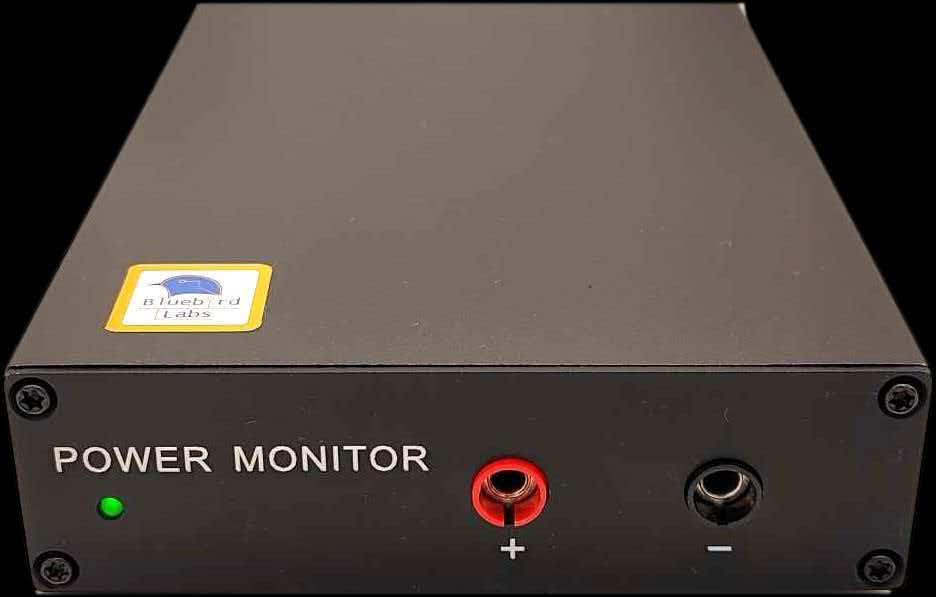
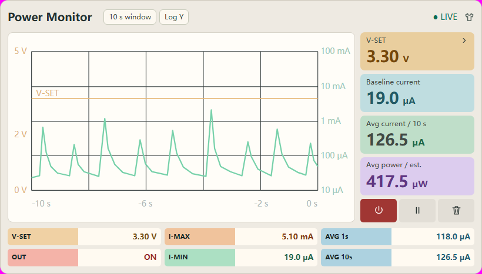
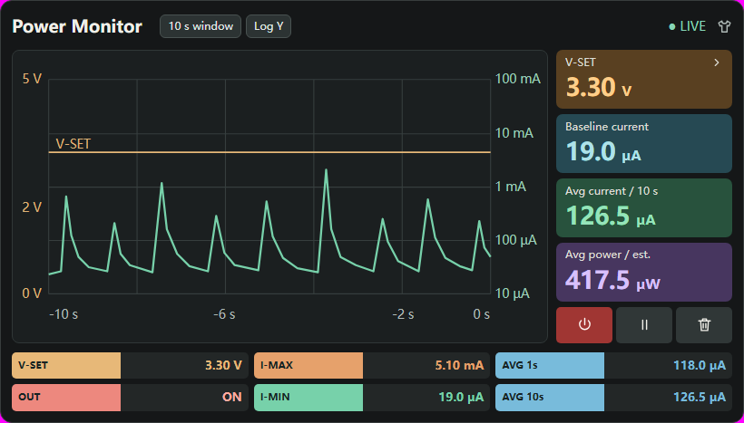

# Power Monitor Touch

用 ESP32-S3 直接读取 USB 功耗仪，在 800 × 480 触摸屏显示电流曲线和统计。开发板独立供电时可离开电脑使用。连上电脑的 USB-to-UART 后，电脑可同时记录实时 CSV，用于分析平均电流、突发负载和事件时间。

## 已验证的硬件

| 组件 | 型号或标识 |
|---|---|
| 主板 | ESP32-S3-LCD-EV-Board-MB v1.4 |
| 显示子板 | ESP32-S3-LCD-EV-BOARD-SUB3 v1.3，800 × 480，GT1151 |
| 功耗仪 | BLU，USB VID:PID 为 `15A2:300A` |
| 编译环境 | ESP-IDF 5.5.3，目标 `esp32s3` |
| 电脑采集 | Python 3、pyserial，USB-to-UART 串口 921600 baud |



## 接线

```text
功耗仪 USB 数据口 ── USB Host ── ESP32-S3 ── USB-to-UART ── 电脑
功耗仪 VOUT / GND ─────────────── 被测设备（DUT）
```

1. 将功耗仪接到开发板的 USB Host。可使用安装在扩展排针上的乐鑫 USB-A Host 转接板。主板 USB-to-USB 口与扩展转接板共享数据线，一次只用其中一条路径。
2. 调试或采集 CSV 时，将开发板标有 USB-to-UART 的口接电脑。通过拔插识别 CP210x 串口，避免选到其他设备的串口。
3. 独立运行时给开发板提供独立电源。屏幕显示 **LIVE** 后，可拔下电脑数据线验证独立采集。
4. 首次测试输出时先断开 DUT，设为 0.50 V。开启后用万用表量 VOUT 对 GND，再关闭确认回到约 0 V。接入 DUT 前核对允许电压和接线极性。

如果自制转接线，断电后用万用表通断档确认两端 VBUS、GND、D+、D− 分别对应，并检查 VBUS 与 GND 没有短路。外壳固定脚与信号地脚的用途以连接器数据手册为准。功耗仪亮灯只说明得到电源，数据连接仍需由 USB 枚举确认。

[乐鑫主板硬件指南](https://docs.espressif.com/projects/esp-dev-kits/en/latest/esp32s3/esp32-s3-lcd-ev-board/user_guide_v1.4.html) · [官方 USB 转接板原理图](https://dl.espressif.com/dl/schematics/SCH_ESP32-S3-LCD-EV-Board-USB-Adapter_V1.1_20231001.pdf)

## 编译和烧录

打开 ESP-IDF 5.5 环境的终端并进入项目根目录。首次编译由 ESP-IDF Component Manager 下载依赖。组件版本由 `dependencies.lock` 锁定，板卡配置在 `sdkconfig.defaults`。

```powershell
idf.py set-target esp32s3
idf.py build
python -m serial.tools.list_ports -v
idf.py -p COM12 flash
```

将 COM12 替换为实际端口。烧录前关闭串口终端和采集脚本，并关闭功耗仪输出。ESP32 重连功耗仪时会发送关闭命令，重启可能中断 DUT 供电。

如果已下载合并镜像 `power-monitor-flash.bin`，可以直接烧录：

```powershell
python -m esptool --chip esp32s3 --port COM12 --baud 460800 write_flash 0x0 power-monitor-flash.bin
```

## 界面预览

设计示意图使用示例读数。

### Light



### Dark



### 操作演示

视频展示主题切换、实时电流曲线和清零操作，时长约 34 秒。

[观看操作演示（MP4）](power-monitor-demo.mp4)

## 屏幕操作

| 位置 | 操作和含义 |
|---|---|
| 顶部时间窗口 | 点击轮换 2、10、30、60 秒，右栏平均电流同时切换窗口 |
| Log Y / Linear Y | 切换电流纵轴。查看低于 1 µA 或负电流时使用线性轴 |
| 右上角 T 恤 | 选择 Dark 或 Light，重启后默认 Dark |
| V-SET | 点击右栏或底栏进入调压页。滑块 0 V 档用于关闭，有源档为 0.50–5.00 V，步进 0.10 V。按左上角箭头返回 |
| 电源图标 | 切换功耗仪输出，开启时按钮红底，底栏 OUT 同时显示状态 |
| 暂停 / 播放图标 | 暂停或恢复画面刷新，采样和电脑端数据流继续 |
| 垃圾桶图标 | 清空当前显示使用的历史和统计，后续样本重新填充曲线 |

黄色曲线表示输出开启时的**电压设定值**，绿色曲线表示采样电流。V-SET 也显示设定值。输出状态根据仪器 USB 命令流程更新，实际 VOUT 可用万用表测量。

### 指标口径

| 指标 | 计算方式 |
|---|---|
| Baseline current | 最近 10 秒内有效的 10 ms 平均电流桶取第 10 百分位，用于观察低电流基线 |
| Avg current | 当前所选时间窗口的有效样本平均值。显示单位为 µA、mA、A 时分别用绿、黄、红 |
| Avg power / est. | 当前输出已开启期间、最近 10 秒有效样本的平均电流乘以设定电压。关闭输出或缺少有效数据时显示 `--` |
| I-MAX / I-MIN | 当前窗口有效样本的最大值和最小值 |
| AVG 1s / AVG 10s | 最近 1 秒和 10 秒的固定窗口平均值 |

平均功耗以设定电压估算。负载变化时的真实端电压需要另行测量，尤其是线缆压降或供电受限时。

## 电脑实时采集

保持功耗仪连接开发板，开发板 USB-to-UART 接电脑。关闭占用串口的监视器，然后运行：

```powershell
python -m pip install pyserial
python receive.py COM12 captures/live.csv
```

输出文件须使用新文件名。按 Ctrl+C 停止采集。脚本逐行写入并刷新文件，可由其他程序增量读取。终端会忽略固件启动日志和不完整的数据行。

| CSV 字段 | 含义 |
|---|---|
| `time_s` | 固件送出的采样时间戳，转换为秒 |
| `epoch_s` | 按电脑接收到首条有效数据的时间对齐的 Unix 时间戳，单位秒 |
| `current_uA` | 一组有效样本的平均电流，单位 µA |

正常情况下每 17 个有效采样生成一行，约每 1.02 ms 一行。很短的脉冲峰值可能被平均。电脑离线期间可在屏上继续观测，重新连接后接收新数据。时间对齐会受串口传输延迟和时钟漂移影响。跨设备精确分析时应使用共同的触发事件或另行标定。

分析功率时，电流需先从 µA 换算为 A，再乘以同步取得的电压。若采用固定设定电压，在分析结果中注明是估算功率。CSV 文件可以按 `epoch_s` 与业务日志、测试步骤或 GPIO 事件对齐。

## 实现结构

- `main/monitor.c` 包含 USB Host 连接、功耗仪校准与采样、输出控制、UART 数据发送和 LVGL 界面。
- `main/history.h` 负责 10 ms 历史桶的聚合。曲线按横轴像素合并桶的极值，保留可见脉冲。自动刷新每秒最多两次。
- `receive.py` 将串口 `PM,<timestamp_us>,<current_uA>` 数据转换成 CSV。
- 屏幕使用 SUB3 的 BSP RGB 时序、行缓冲和双帧缓冲。复现或排查画面重影时，应同时记录屏幕子板、ESP-IDF 版本和编译配置。

## 常见问题

| 现象 | 检查 |
|---|---|
| 功耗仪亮灯，屏幕显示 NO LIVE DATA | 核对 USB Host 接口和 D+/D−。重插功耗仪后查看串口是否出现 `USB device 15a2:300a`、`Calibration received` |
| Windows 串口拒绝访问 | 关闭 SecureCRT、串口监视器或旧采集脚本，拔插确认当前 CP210x 端口后重试 |
| 电源图标无法开启 | 查看 USB 数据是否已上线，并确认 V-SET 至少为 0.50 V |
| 输出显示开启但负载没电 | 断开 DUT 后测功耗仪 VOUT 对 GND，再检查负载接线和压降 |
| 重绘时整屏抖动或出现重影 | 确认使用 SUB3 对应配置，保留 BSP 行缓冲与双帧缓冲，记录能稳定复现的窗口和轴模式 |

第三方依赖由 ESP-IDF Component Manager 获取，各组件遵循各自的许可证。

## 许可证

项目原创源码和文档采用 [MIT 许可证](LICENSE)。
